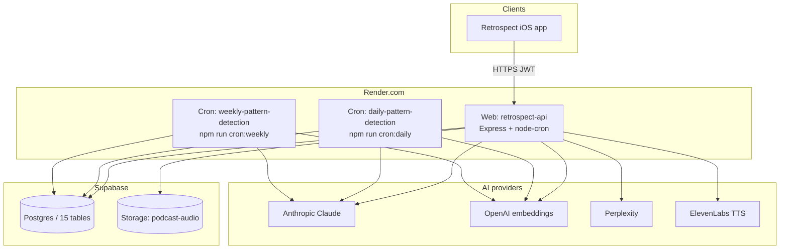
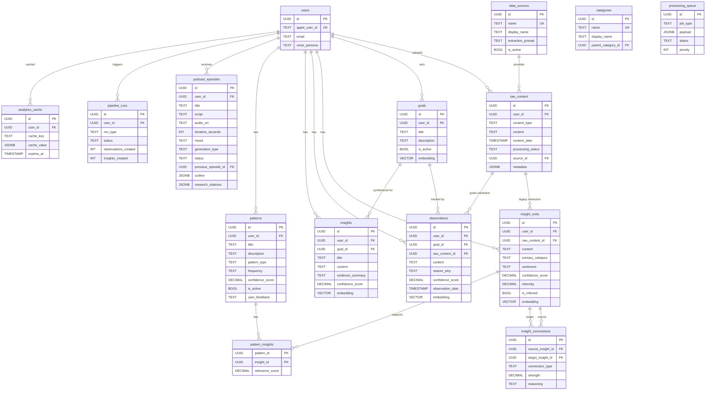
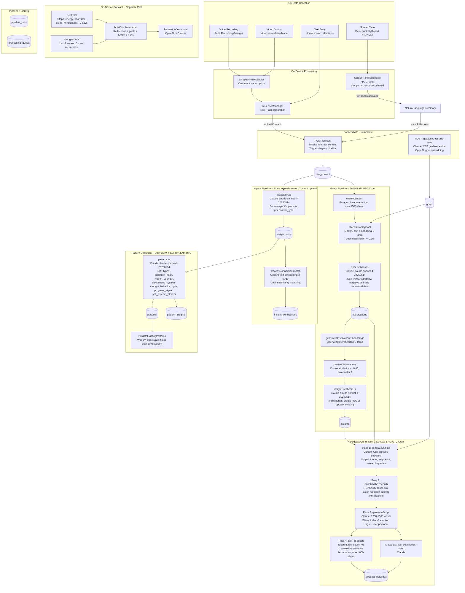

# Retrospect Data Model and Pipeline — Complete Reference

This document describes the Supabase **PostgreSQL** data model (15 tables), foreign-key relationships, CHECK constraints, and how data is **written and read through the Render-hosted API** (Node/Express in `backend/`). It also covers the processing pipeline from iOS through cron jobs and LLM calls. Open [`retrospect-data-model-and-pipeline.html`](retrospect-data-model-and-pipeline.html) in a browser for the same diagrams rendered with Mermaid.js.

**See also:** [Full-stack architecture map](retrospect-full-stack-architecture.md) (iOS ↔ Render ↔ Supabase ↔ external APIs, ASCII + optional Mermaid).

**Full-system data flow (single diagram):** [`docs/diagrams/retrospect-full-system-data-flow.mmd`](diagrams/retrospect-full-system-data-flow.mmd) (Mermaid source) and [`docs/diagrams/retrospect-full-system-data-flow.png`](diagrams/retrospect-full-system-data-flow.png) (high-res PNG) — capture, local stores, Render API, Postgres, Storage, `node-cron` vs Render Cron caveat, external AI edges, `/admin`, `/profile`, on-device podcast fork.

---

## Platform topology: client, Render, Supabase

The **authoritative store** for user data is **Supabase Postgres** (with `pgvector`). The **only production server** the iOS app calls for sync is the **Render web service**: Express serves HTTPS JSON, validates **JWTs** minted after Sign in with Apple, and uses the **Supabase service role** key server-side so it can read/write all tables without per-row mobile RLS complexity. Optional **Supabase Storage** (e.g. bucket `podcast-audio`) holds generated MP3s; `podcast_episodes.audio_url` points at the uploaded object URL.



### Render blueprint (`backend/render.yaml`)

| Piece | Purpose |
|-------|---------|
| **Web service `retrospect-api`** | Runs `npm run build` then `npm start` (Node `dist/index.js`). **Health check:** `GET /health`. Default **region** in blueprint: Oregon. |
| **Cron `daily-pattern-detection`** | Schedule `0 3 * * *` (03:00 UTC daily) → `npm run cron:daily` (patterns over `insight_units`). Receives `SUPABASE_URL`, `SUPABASE_SERVICE_KEY`, `OPENAI_API_KEY` from the web service env sync in the blueprint. |
| **Cron `weekly-pattern-detection`** | Schedule `0 4 * * 0` (04:00 UTC Sundays) → `npm run cron:weekly`. Same env sync pattern. |

**Important:** `backend/src/index.ts` also registers **in-process `node-cron`** with the **same UTC schedules** (03:00 daily patterns, 04:00 Sun weekly patterns, 05:00 daily observations→insights, 06:00 Sun podcast). If both the **web process** and **Render Cron** jobs are enabled with overlapping duties, work may **run twice** for pattern steps. Prefer **one** scheduling mechanism in production (e.g. only `node-cron` on the web service, or only Render Cron with extended blueprint env for Anthropic/podcast keys—see below).

**Cron entrypoints (same repo, `backend/package.json`):** `cron:daily` → `src/jobs/daily-patterns.ts`; `cron:weekly` → `src/jobs/weekly-patterns.ts`; `cron:pipeline` → `src/jobs/observation-insights-pipeline.ts`; `cron:podcasts` → `src/jobs/weekly-podcast-generation.ts`. The web process invokes the first four schedules via `node-cron` in `src/index.ts`; the Render blueprint only wires **daily + weekly pattern** crons in `render.yaml`—**observations/insights** and **podcast** schedules rely on the **live web service** unless you add matching Render Cron services.

| Schedule (UTC) | Job | Main tables touched |
|----------------|-----|---------------------|
| 03:00 daily | Daily patterns | **`insight_units`** → **`patterns`**, **`pattern_insights`** |
| 04:00 Sunday | Weekly patterns + validation | **`patterns`**, **`pattern_insights`**, **`insight_units`** |
| 05:00 daily | Observations → insights pipeline | **`raw_content`**, **`goals`**, **`observations`**, **`insights`**, **`pipeline_runs`** |
| 06:00 Sunday | Weekly podcast | **`podcast_episodes`**, Storage **`podcast-audio`**; reads **`insights`**, **`observations`**, **`goals`**, **`users`** |

### Environment variables (backend `config`)

The Express app **requires** (see `backend/src/utils/config.ts`): `SUPABASE_URL`, `SUPABASE_SERVICE_KEY`, `SUPABASE_ANON_KEY`, `ANTHROPIC_API_KEY`, `OPENAI_API_KEY`, `JWT_SECRET`. **Optional** (feature-gated): `PERPLEXITY_API_KEY`, `ELEVENLABS_API_KEY`, `ELEVENLABS_VOICE_ID`, Apple verification keys (`APPLE_TEAM_ID`, `APPLE_KEY_ID`, `APPLE_PRIVATE_KEY`), `ADMIN_SECRET` (for `/admin` dashboard, not JWT). The committed **`render.yaml` only lists** a subset for the web service (`OPENAI_API_KEY`, Supabase, `JWT_SECRET`, rate limits); you must **add the rest in the Render dashboard** (especially `ANTHROPIC_API_KEY` and podcast-related keys).

---

## API surface → tables (Render Express)

All routes below are under the deployed host (e.g. `https://retrospect-api.onrender.com`) unless noted. **JWT** = `Authorization: Bearer` after `POST /auth/signin`. The **`/insights` REST API exposes `insight_units`** (legacy atomic insights), not the **`insights`** table (goal-synthesized rows)—naming is easy to confuse.

### User auth and profile

| HTTP | Path | Auth | Primary tables / effects |
|------|------|------|---------------------------|
| POST | `/auth/signin` | None | **`users`** upsert by `apple_user_id`; returns JWT. |
| POST | `/auth/refresh` | Refresh flow | Re-issues JWT tied to **`users`**. |
| GET | `/profile` | JWT | Read **`users`** (e.g. persona). |
| PATCH | `/profile/persona` | JWT | Update **`users.voice_persona`** (CHECK: thoughtful_friend, wise_mentor, energetic_host). |
| GET | `/profile/personas` | JWT | Allowed persona list (app UX; persists on **`users`**). |

### Content ingestion (dual pipeline input)

| HTTP | Path | Auth | Primary tables / effects |
|------|------|------|---------------------------|
| POST | `/content` | JWT | Inserts **`raw_content`** (`processing_status` pending→processing/completed); resolves **`data_sources.id`** by matching `content_type` to `data_sources.name`; runs **`extraction`** → **`insight_units`**; then **`connections`** batch → **`insight_connections`** + embeddings on units. |
| GET | `/content` | JWT | Lists **`raw_content`**. |
| GET | `/content/:id` | JWT | **`raw_content`** + related **`insight_units`**. |
| POST | `/content/:id/reprocess` | JWT | Re-runs extraction/connections for that row. |
| DELETE | `/content/:id` | JWT | Deletes content (cascades depend on FK definitions in migrations). |

**Goals pipeline** does not run inside `POST /content`; it runs on **schedule** or **manual pipeline routes** (below), reading **`raw_content`** + **`goals`**.

### Legacy insights API (`insight_units` + `insight_connections`)

| HTTP | Path | Auth | Primary tables |
|------|------|------|----------------|
| GET | `/insights` | JWT | **`insight_units`** (filters, pagination). |
| GET | `/insights/:id` | JWT | **`insight_units`**. |
| GET | `/insights/:id/connections` | JWT | **`insight_connections`** (+ linked units). |
| POST | `/insights/search` | JWT | Vector search over **`insight_units.embedding`**. |
| PATCH / DELETE | `/insights/:id` | JWT | Mutate / remove **`insight_units`**. |
| GET | `/insights/categories/summary` | JWT | Aggregates on **`insight_units`** categories. |

### Goals, observations, synthesized insights (`goals` / `observations` / `insights`)

| HTTP | Path | Auth | Primary tables |
|------|------|------|----------------|
| POST / GET / GET :id / PATCH / DELETE | `/goals` | JWT | **`goals`** CRUD; embeddings on create/update where implemented. |
| POST | `/goals/extract` | JWT | Claude extracts goal text from body (response only unless paired with save). |
| POST | `/goals/extract-and-save` | JWT | Claude + **`goals`** rows + embeddings. |
| POST | `/pipeline/observations/extract` | JWT | Chunk/match **`raw_content`** to **`goals`** → **`observations`**. |
| POST | `/pipeline/observations/extract/:contentId` | JWT | Same for one content id. |
| GET | `/pipeline/observations` | JWT | **`observations`**. |
| POST | `/pipeline/insights/generate` | JWT | Cluster/synthesize → **`insights`** (and may touch **`pipeline_runs`** / tracking in services). |
| GET | `/pipeline/insights` | JWT | **`insights`** list. |
| GET | `/pipeline/insights/:id` | JWT | Single **`insights`** row. |
| POST | `/pipeline/run` | JWT | Orchestrated run; records **`pipeline_runs`**. |
| GET | `/pipeline/runs` | JWT | **`pipeline_runs`**. |

### Patterns (`patterns` / `pattern_insights` + reads on `insight_units`)

| HTTP | Path | Auth | Primary tables |
|------|------|------|----------------|
| GET | `/patterns` | JWT | **`patterns`**. |
| GET | `/patterns/:id` | JWT | **`patterns`** + **`pattern_insights`** → **`insight_units`**. |
| PUT | `/patterns/:id/feedback` | JWT | **`patterns.user_feedback`** (CHECK: confirmed, rejected, unsure). |
| POST | `/patterns/detect` | JWT | Triggers detection job (writes **`patterns`**, **`pattern_insights`**). |
| DELETE | `/patterns/:id` | JWT | Dismiss / remove pattern per route logic. |
| GET | `/patterns/stats/summary` | JWT | Stats over **`patterns`**. |

Cron jobs `daily-patterns` / `weekly-patterns` call the same detection stack over recent **`insight_units`**.

### Analytics (read-mostly over legacy graph)

| HTTP | Path | Auth | Primary sources |
|------|------|------|-----------------|
| GET | `/analytics/summary` | JWT | **`insight_units`**, **`insight_connections`**, **`patterns`** (aggregations). |
| GET | `/analytics/timeline` | JWT | **`insight_units`** time buckets. |
| GET | `/analytics/emotions` | JWT | Tags / sentiment on **`insight_units`**. |
| GET | `/analytics/connections` | JWT | **`insight_connections`**. |
| GET | `/analytics/categories` | JWT | **`insight_units`** categories. |

The **`analytics_cache`** table exists in schema and `Tables` constants for future or optional caching; not all analytics paths may persist to it yet.

### Podcasts (`podcast_episodes` + Storage)

| HTTP | Path | Auth | Primary tables / storage |
|------|------|------|---------------------------|
| GET | `/podcasts` | JWT | **`podcast_episodes`**. |
| GET | `/podcasts/latest` | JWT | Latest **`podcast_episodes`** for user. |
| GET | `/podcasts/:id` | JWT | One episode; **`audio_url`** typically Supabase public/signed URL. |
| POST | `/podcasts/generate` | JWT | Full server pipeline: reads **`insights`**, **`observations`**, **`goals`**, **`users`**, prior episode; calls Claude / Perplexity / ElevenLabs; uploads audio; inserts/updates **`podcast_episodes`**. |

Weekly **06:00 UTC Sunday** cron (`runWeeklyPodcastGeneration`) performs the same class of work for eligible users.

### Admin (`/admin/*`, `ADMIN_SECRET`, not JWT)

Dashboard and operator routes (`backend/src/routes/admin.ts`) can list or trigger **users**, **goals**, **content**, **observations**, **insights** (both kinds), **pipeline** actions, **podcasts**, and **stats**. Treat as **break-glass**; they bypass normal app JWT.

### Schema tables with no dedicated REST resource in v1

| Table | Role |
|-------|------|
| **`categories`** | Taxonomy; referenced by domain logic and seeds; not always exposed as a standalone CRUD router in Express. |
| **`processing_queue`** | Defined for async job payload/status; **constants exist** in backend but **queue writers may not be wired** in all code paths—check migrations and jobs before assuming behavior. |
| **`analytics_cache`** | Keyed JSON cache with TTL; available for **analytics** performance. |

---

## Diagram 1: Entity-Relationship Model

Shows all 15 tables with key columns (PK, FKs, top business columns) and every foreign-key relationship. Full column inventories follow below the diagram.



### Full column inventory

**users** — `id` UUID PK, `apple_user_id` TEXT UNIQUE NOT NULL, `email` TEXT, `voice_persona` TEXT DEFAULT 'thoughtful_friend', `created_at` TIMESTAMPTZ, `updated_at` TIMESTAMPTZ

**data_sources** — `id` UUID PK, `name` TEXT UNIQUE NOT NULL, `display_name` TEXT NOT NULL, `description` TEXT, `is_active` BOOL DEFAULT true, `extraction_prompt` TEXT, `created_at` TIMESTAMPTZ

**categories** — `id` UUID PK, `name` TEXT UNIQUE NOT NULL, `display_name` TEXT NOT NULL, `description` TEXT, `parent_category_id` UUID FK self-ref, `color` TEXT, `icon` TEXT, `sort_order` INT DEFAULT 0, `created_at` TIMESTAMPTZ

**raw_content** — `id` UUID PK, `user_id` UUID FK users, `content_type` TEXT NOT NULL, `content` TEXT NOT NULL, `content_date` TIMESTAMPTZ, `metadata` JSONB DEFAULT '{}', `processing_status` TEXT DEFAULT 'pending', `processing_error` TEXT, `source_id` UUID FK data_sources, `created_at` TIMESTAMPTZ, `processed_at` TIMESTAMPTZ

**goals** — `id` UUID PK, `user_id` UUID FK users, `title` TEXT NOT NULL, `description` TEXT, `is_active` BOOL DEFAULT true, `embedding` VECTOR(3072), `created_at` TIMESTAMPTZ, `updated_at` TIMESTAMPTZ

**insight_units** — `id` UUID PK, `user_id` UUID FK users, `raw_content_id` UUID FK raw_content, `content` TEXT NOT NULL, `primary_category` TEXT NOT NULL, `secondary_categories` TEXT[], `is_inferred` BOOL DEFAULT false, `confidence_score` DECIMAL(3,2) DEFAULT 1.0, `inference_reasoning` TEXT, `insight_date` TIMESTAMPTZ NOT NULL, `sentiment` TEXT, `emotion_tags` TEXT[], `intensity` DECIMAL(3,1), `embedding` VECTOR(3072), `metadata` JSONB DEFAULT '{}', `created_at` TIMESTAMPTZ, `updated_at` TIMESTAMPTZ

**insight_connections** — `id` UUID PK, `source_insight_id` UUID FK insight_units, `target_insight_id` UUID FK insight_units, `connection_type` TEXT NOT NULL, `strength` DECIMAL(3,2) DEFAULT 0.5, `reasoning` TEXT, `is_bidirectional` BOOL DEFAULT false, `created_at` TIMESTAMPTZ. UNIQUE on (source, target, type).

**patterns** — `id` UUID PK, `user_id` UUID FK users, `title` TEXT NOT NULL, `description` TEXT NOT NULL, `pattern_type` TEXT NOT NULL, `categories` TEXT[], `supporting_insight_ids` UUID[], `confidence_score` DECIMAL(3,2) DEFAULT 0.5, `frequency` TEXT, `time_range_start` TIMESTAMPTZ, `time_range_end` TIMESTAMPTZ, `is_active` BOOL DEFAULT true, `user_acknowledged` BOOL DEFAULT false, `user_feedback` TEXT, `feedback_notes` TEXT, `metadata` JSONB DEFAULT '{}', `created_at` TIMESTAMPTZ, `updated_at` TIMESTAMPTZ, `last_validated_at` TIMESTAMPTZ

**pattern_insights** — `pattern_id` UUID FK patterns, `insight_id` UUID FK insight_units. Composite PK. `relevance_score` DECIMAL(3,2) DEFAULT 0.5, `created_at` TIMESTAMPTZ

**observations** — `id` UUID PK, `user_id` UUID FK users, `goal_id` UUID FK goals, `raw_content_id` UUID FK raw_content, `content` TEXT NOT NULL, `reason_why` TEXT NOT NULL, `confidence_score` DECIMAL(3,2) DEFAULT 0.8, `observation_date` TIMESTAMPTZ NOT NULL, `embedding` VECTOR(3072), `metadata` JSONB DEFAULT '{}', `created_at` TIMESTAMPTZ

**insights** — `id` UUID PK, `user_id` UUID FK users, `goal_id` UUID FK goals, `title` TEXT NOT NULL, `content` TEXT NOT NULL, `evidence_summary` TEXT NOT NULL, `supporting_observation_ids` UUID[], `confidence_score` DECIMAL(3,2) DEFAULT 0.7, `time_range_start` TIMESTAMPTZ, `time_range_end` TIMESTAMPTZ, `embedding` VECTOR(3072), `metadata` JSONB DEFAULT '{}', `created_at` TIMESTAMPTZ, `updated_at` TIMESTAMPTZ

**pipeline_runs** — `id` UUID PK, `user_id` UUID FK users, `run_type` TEXT NOT NULL, `status` TEXT DEFAULT 'running', `raw_content_ids` UUID[], `observations_created` INT DEFAULT 0, `insights_created` INT DEFAULT 0, `error_message` TEXT, `started_at` TIMESTAMPTZ, `completed_at` TIMESTAMPTZ

**podcast_episodes** — `id` UUID PK, `user_id` UUID FK users, `title` TEXT NOT NULL, `description` TEXT, `script` TEXT NOT NULL, `audio_url` TEXT, `duration_seconds` INT, `mood` TEXT, `generation_type` TEXT DEFAULT 'weekly', `status` TEXT DEFAULT 'generating', `insight_ids` UUID[], `goal_ids` UUID[], `research_citations` JSONB DEFAULT '[]', `outline` JSONB DEFAULT '{}', `episode_number` INT, `covers_period_start` TIMESTAMPTZ, `covers_period_end` TIMESTAMPTZ, `previous_episode_id` UUID FK self-ref, `topics_covered` TEXT[], `error_message` TEXT, `metadata` JSONB DEFAULT '{}', `created_at` TIMESTAMPTZ, `updated_at` TIMESTAMPTZ

**processing_queue** — `id` UUID PK, `job_type` TEXT NOT NULL, `payload` JSONB NOT NULL, `status` TEXT DEFAULT 'pending', `priority` INT DEFAULT 0, `attempts` INT DEFAULT 0, `max_attempts` INT DEFAULT 3, `error_message` TEXT, `created_at` TIMESTAMPTZ, `started_at` TIMESTAMPTZ, `completed_at` TIMESTAMPTZ

**analytics_cache** — `id` UUID PK, `user_id` UUID FK users, `cache_key` TEXT NOT NULL, `cache_value` JSONB NOT NULL, `expires_at` TIMESTAMPTZ NOT NULL, `created_at` TIMESTAMPTZ. UNIQUE on (user_id, cache_key).

### Key CHECK constraints

- **raw_content.content_type** (app / extraction convention): voice_recording, text_entry, google_docs, healthkit, calendar, video_entry, screen_time, twitter_bookmarks
- **raw_content.processing_status**: pending, processing, completed, failed
- **insight_units.sentiment**: positive, negative, neutral, mixed
- **insight_units.confidence_score**: 0 to 1 — **intensity**: 1 to 10
- **insight_connections.connection_type**: same_topic, causal, temporal, supports, contradicts
- **patterns.pattern_type**: correlation, trend, cycle, anomaly, habit
- **patterns.frequency**: daily, weekly, monthly, occasional, one_time
- **patterns.user_feedback**: confirmed, rejected, unsure
- **pipeline_runs.run_type**: observation_extraction, insight_generation, full_pipeline
- **pipeline_runs.status**: running, completed, failed
- **podcast_episodes.generation_type**: weekly, on_demand, milestone
- **podcast_episodes.status**: generating, ready, failed
- **users.voice_persona**: thoughtful_friend, wise_mentor, energetic_host
- **Embeddings**: VECTOR(3072) via OpenAI `text-embedding-3-large`; ivfflat indexes where enabled in migrations

---

## Diagram 2: Full processing pipeline

Shows data flow from iOS collection through both backend pipelines, cron jobs, LLM providers at each step, and the separate on-device podcast path.



### Cron schedule reference

- **Daily 3 AM UTC** — `daily-patterns.ts`: `detectDailyPatterns()` for users with `insight_units` in last 7 days. Filters for ≥ 3 supporting insights, confidence ≥ 0.6.
- **Sunday 4 AM UTC** — `weekly-patterns.ts`: `detectWeeklyPatterns()` for users with `insight_units` in last 30 days; validates existing patterns and deactivates stale ones.
- **Daily 5 AM UTC** — `observation-insights-pipeline.ts`: `processAllPendingContent()` then `generateInsightsForAllGoals()` for users with active goals.
- **Sunday 6 AM UTC** — `weekly-podcast-generation.ts`: `generatePodcastEpisode()` for users whose insights were updated in last 7 days.

### LLM provider reference

- **Anthropic Claude** (`claude-sonnet-4-20250514`): insight extraction, observation extraction, insight synthesis, podcast outline/script/metadata, pattern detection, goal extraction, connection analysis
- **OpenAI** (`text-embedding-3-large`): embeddings for goals, chunks, insight_units, observations, insights (3072-dimensional vectors)
- **Perplexity** (`sonar-pro`): podcast research enrichment with citations
- **ElevenLabs** (`eleven_v3`): podcast TTS, chunked at sentence boundaries (max 4800 chars per request)
- **On-device (iOS)**: Claude or OpenAI via `AIServiceManager` for metadata generation and local podcast transcripts

### Dual pipeline architecture

The system runs two parallel pipelines from the same `raw_content`:

- **Legacy pipeline** (immediate): `raw_content` → `extraction.ts` → `insight_units` → `insight_connections`. Used by pattern detection.
- **Goals pipeline** (daily cron): `raw_content` + `goals` → `observations.ts` → `observations` → `insight-synthesis.ts` → `insights`. Used by podcast generation.

Both pipelines read from `raw_content` but write to different outputs. Pattern detection reads `insight_units` (legacy). Podcast generation reads `insights` and `observations` (goals pipeline).

### iOS data sources

**Uploaded to backend** (`POST /content`):

- `voice_recording` — AudioRecordingManager; transcribed on-device via `SFSpeechRecognizer`
- `text_entry` — Home screen reflections
- `video_entry` — VideoJournalViewModel; transcribed on-device
- `screen_time` — ScreenTimeService; natural-language summary

**Used on-device only** (not uploaded):

- HealthKit — 7-day health summary (steps, energy, heart rate, sleep, mindfulness)
- Google Docs — last ~2 weeks of documents via Google Drive API

**Defined in backend but not implemented as iOS uploads**:

- calendar, twitter_bookmarks, healthkit (as upload type), google_docs (as upload type)

### Notification system (local only)

- New podcast notification with hook text
- Follow-up reminder (configurable delay)
- Weekly reflection reminder (Sundays 10:00)
- Mid-week check-in (Wednesdays 20:00)
- All local via `UNUserNotificationCenter` — no APNs push server

---

## Verifying diagrams locally

**Render + DB implementation (authoritative for route ↔ table behavior):**

- [`backend/src/index.ts`](../backend/src/index.ts) — Express route mounts, `node-cron` schedules
- [`backend/render.yaml`](../backend/render.yaml) — Render web + cron blueprint
- [`backend/src/utils/supabase.ts`](../backend/src/utils/supabase.ts) — `Tables` constants matching Postgres relations
- [`backend/src/routes/`](../backend/src/routes/) — Per-resource HTTP handlers

Source files (same diagrams as in this doc):

- [`docs/diagrams/retrospect-er.mmd`](diagrams/retrospect-er.mmd)
- [`docs/diagrams/retrospect-pipeline.mmd`](diagrams/retrospect-pipeline.mmd)
- [`docs/diagrams/retrospect-full-system-data-flow.mmd`](diagrams/retrospect-full-system-data-flow.mmd) (end-to-end system + AI + cron)

```bash
npx @mermaid-js/mermaid-cli@11.4.0 -i docs/diagrams/retrospect-er.mmd -o retrospect-er.png
npx @mermaid-js/mermaid-cli@11.4.0 -i docs/diagrams/retrospect-pipeline.mmd -o retrospect-pipeline.png
npx @mermaid-js/mermaid-cli@11.4.0 -i docs/diagrams/retrospect-full-system-data-flow.mmd -o docs/diagrams/retrospect-full-system-data-flow.png -w 3600 -H 24000 -s 3 -b white
```

Or open [`retrospect-data-model-and-pipeline.html`](retrospect-data-model-and-pipeline.html) in a browser.
